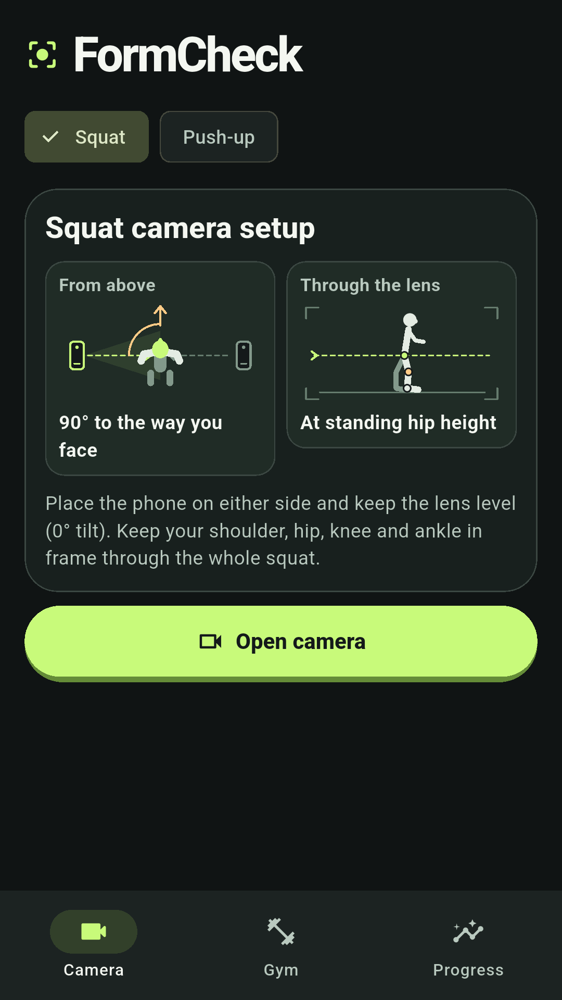
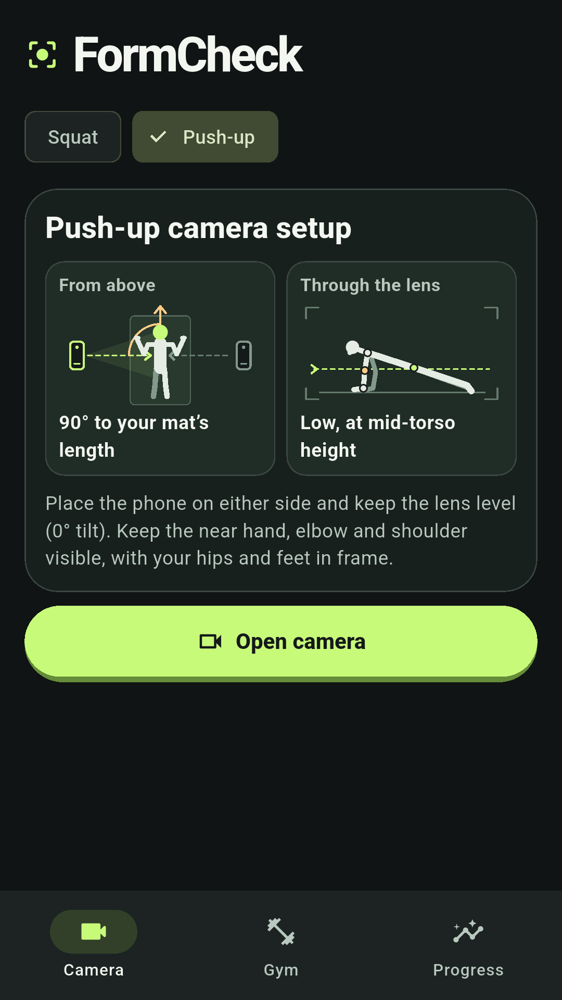

# FormCheck

FormCheck is a camera-first Flutter workout coach for #BuildHybridAI 2026. It uses on-device MediaPipe pose tracking for squats and push-ups, a local gym log, and Firebase AI Logic hybrid inference for next-set coaching.

Android is the primary judging target. See [plan.md](plan.md) for the platform matrix, architecture, and release evidence, and [AGENTS.md](AGENTS.md) for project rules and reference sources.

[Devpost challenge](https://firebasehybridaihackathon.devpost.com/) · [Official rules](https://firebasehybridaihackathon.devpost.com/rules)

Project code is licensed under [Apache-2.0](LICENSE). Third-party notices apply to any components identified in the repository.

## Test the Android app

Use an ARM64 phone running Android 9 or later. Open the APK to update an earlier signed FormCheck build and keep your workout history. [Download the signed FormCheck 0.1.6 APK](https://github.com/localtradings/formcheck/releases/download/v0.1.6/FormCheck-0.1.6-android-arm64.apk)

Choose an exercise on the Camera tab to see two drawings showing where to put the phone and what its camera should see.

 

| Exercise | Where to put the phone | What FormCheck checks |
| --- | --- | --- |
| Bodyweight squat | Beside you at standing hip height. Point the lens straight across, 90° to the direction you face. | Your hips move down and back up, your observed knee bends to the profile's target, and you return to standing. |
| Floor push-up | Low beside the middle of your torso, 90° to the long edge of the mat. Leave room to see your hand and feet. | Your shoulders lower and return, the observed elbow reaches the depth target, and your shoulder, hip and ankle stay in line. |

For either exercise, aim for 0° lens tilt. The live camera distinguishes the estimated side angle, the phone’s tilt and the bending joint’s angle. If a number is unavailable, follow the setup drawing. With a clear view, hold the start position and tap **Start set**. After the set, browse individual reps to see the measured bottom angle when available and the cue associated with that rep.

For a quick check, finish one rep from the side. Move the phone to face you halfway through the next rep, then return it to your side. The completed rep should stay in the set. Wait for **Ready for the next rep** before trying again. Repeat with the other exercise. In a push-up setup, the camera can also cue visible hip misalignment before you start the set. [Release notes and checksum](https://github.com/localtradings/formcheck/releases/tag/v0.1.6)

## Build from source

1. Install Flutter **3.50.0** and use its bundled Dart. Android builds use the Android 36 SDK and the NDK version specified by Flutter, with JDK 21 recommended. iOS uses Xcode 26.2 or newer with Swift Package Manager. Simulator builds require Apple Silicon because the bundled MediaPipe runtime supplies an ARM64 simulator slice.
2. Run `flutter pub get` and `dart run tool/prepare_pose_model.dart`. The setup tool uses MediaPipe's verified model store to download Google's pinned Full pose model and check its SHA-256. The model is then bundled in the app for offline use.
3. Run `flutter analyze` and `flutter test`.
4. Run `flutter run` with a supported phone attached. The camera, workout history and built-in cues work with the downloaded model and without Firebase project credentials. Test camera framing and rep behavior on physical hardware.

To enable the hybrid coach, use a Firebase project with the Gemini Developer API, Firebase AI Logic and App Check enforcement. Register Android and iOS as `com.localtradings.formcheck`. Supply your team's Firebase client configurations at `android/app/google-services.json` and `ios/Runner/GoogleService-Info.plist`. Both files are ignored. Use the debug provider only for development and keep all debug tokens private. See [Android hybrid setup](https://firebase.google.com/docs/ai-logic/hybrid/android/get-started), [iOS hybrid setup](https://firebase.google.com/docs/ai-logic/hybrid/ios/get-started) and [Firebase App Check](https://firebase.google.com/docs/ai-logic/app-check).

Android judging builds use Play Integrity and the private release signing configuration in `android/key.properties`. Register that signing certificate’s SHA-256 in Firebase. Use the documented Play Integrity settings for APKs distributed outside Google Play. Build with `flutter build apk --release --target-platform android-arm64 --split-per-abi`. The signed ARM64 APK is written to `build/app/outputs/flutter-apk/app-arm64-v8a-release.apk`. On iOS, configure your Apple development team and App Attest. Apple SDK 12.19.2 is pinned because it contains the Firebase `HybridModel` API used here. [Play Integrity configuration](https://firebase.google.com/docs/app-check/android/play-integrity-provider) · [Apple SDK release notes](https://firebase.google.com/support/release-notes/ios)

Measure camera pipeline performance with `--dart-define=FORMCHECK_TIMINGS=true` in a profiling or release build and collect the aggregate timing logs. Run five minutes on the older Android test phone with its normal camera placement. Measurement uses camera frame receipt through the post-frame callback.
